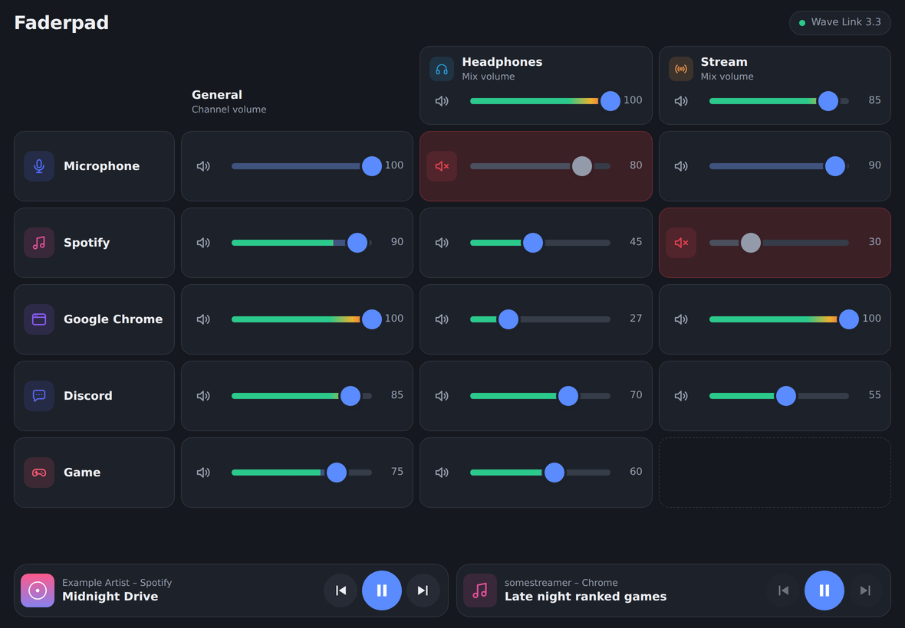
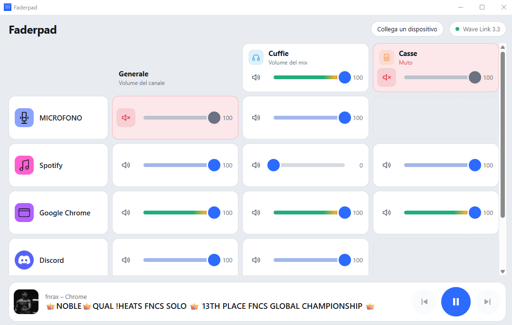
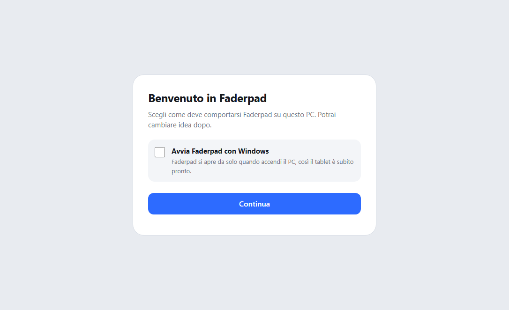
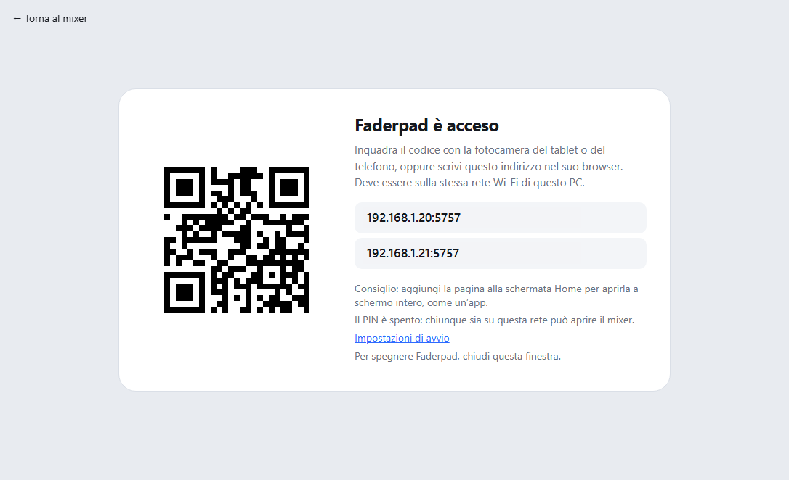

<p align="center">
  
</p>

<h1 align="center">Faderpad</h1>

<p align="center">
  Comanda Elgato Wave Link dal tablet o dal telefono.<br>
  <a href="../../releases/latest"><strong>Scarica per Windows</strong></a> · <a href="README.md">English</a>
</p>

<p align="center">
  
</p>

Faderpad trasforma qualsiasi tablet o telefono in un mixer touch per Wave Link 3. Mostra la stessa griglia di Wave Link, con i tuoi canali, i tuoi mix e i livelli audio in diretta, così puoi abbassare la musica o silenziare una chiamata senza uscire dal gioco.

> Faderpad è un progetto open source indipendente. Non è realizzato, approvato o supportato da Elgato.

## Cosa fa

- **Funziona con la tua configurazione, qualunque sia.** Canali e mix vengono letti da Wave Link ogni volta, quindi Faderpad mostra esattamente quello che hai impostato.
- **Tutti i fader.** Il volume di ogni canale, di ogni canale dentro ogni mix e di ogni mix nel complesso. Ognuno si silenzia con un tocco.
- **Livelli audio in diretta** dentro i fader, come in Wave Link.
- **Controlli multimediali per qualsiasi app**: Spotify, una scheda di Twitch o YouTube, Apple Music, VLC e ogni app che Windows riconosce, con titolo, artista e copertina. Se ne suonano più di una, ognuna ha la sua scheda.
- **Funziona nel browser.** iPad, tablet Android, telefono o un altro computer. Aggiungila alla schermata Home e si apre a schermo intero, come un'app.
- **Si collega in un attimo.** All'avvio il PC mostra un QR code da inquadrare con il tablet.
- **PIN opzionale**, così chi è sulla tua rete non può cambiarti i volumi.
- Tema chiaro e scuro dalle impostazioni del dispositivo. Inglese e italiano.

## Cosa serve

- Windows 10 o 11 con [Elgato Wave Link](https://www.elgato.com/wave-link) 3 aperto
- Un tablet o un telefono sulla stessa rete del PC

## Come iniziare

1. Scarica **Faderpad.exe** dall'[ultima release](../../releases/latest).
2. Apri Wave Link, poi fai doppio clic su Faderpad.exe.
3. La prima volta Windows Firewall chiede se Faderpad può usare la rete: consentilo sulle reti private.
4. Sul PC si apre il mixer in una finestra tutta sua. Per collegare un tablet o un telefono, premi **Collega un dispositivo** e inquadra il QR code, oppure scrivi l'indirizzo che mostra.

<p align="center">
  
</p>

Tieni aperta la finestra di Faderpad mentre lo usi (ridurla a icona va bene); chiudila per spegnerlo. Se qualcosa non va, il file `faderpad.log` accanto a Faderpad.exe spiega perché.

La prima volta una schermata di benvenuto chiede se Faderpad deve avviarsi con Windows. Puoi cambiare idea in seguito dalla pagina di collegamento (**Impostazioni di avvio**).

<p align="center">
  
</p>

Faderpad.exe non ha una firma digitale, quindi la prima volta Windows SmartScreen potrebbe avvisarti. Scegli **Ulteriori informazioni**, poi **Esegui comunque**.

### Fissare Faderpad alla barra delle applicazioni

Per aprire Faderpad con un clic, come qualsiasi altra app:

1. Avvia Faderpad. La sua icona compare nella barra delle applicazioni.
2. Fai clic destro sull'icona e scegli **Aggiungi alla barra delle applicazioni**.

Puoi anche fare clic destro su **Faderpad.exe**, scegliere **Mostra altre opzioni** e poi **Aggiungi alla barra delle applicazioni**. Tieni Faderpad.exe in una cartella che non cambia, per esempio `Documenti\Faderpad`: se lo sposti, il collegamento fissato smette di funzionare e va fissato di nuovo.

<p align="center">
  
</p>

## Impostazioni

Metti un file chiamato `faderpad.json` accanto a Faderpad.exe (c'è un esempio in [`faderpad.example.json`](faderpad.example.json)):

```json
{
  "port": 5757,
  "pin": "1234",
  "open_browser": true
}
```

| Impostazione | Predefinito | Cosa fa |
| --- | --- | --- |
| `port` | `5757` | La porta a cui si collega il tablet. Cambiala se 5757 è già usata da altro. |
| `pin` | nessuno | Gli altri dispositivi devono inserire questo PIN una volta prima di poter comandare qualcosa. Il PC stesso non lo chiede mai. |
| `open_browser` | `true` | All'avvio apre la finestra di Faderpad sul PC. Con `false` parte solo il server. |

Le stesse opzioni funzionano da riga di comando: `Faderpad.exe --port 6000 --pin 1234 --no-browser`. Con `Faderpad.exe --help` vedi l'elenco completo.

## Come funziona

```
Browser del tablet  <-- la tua rete -->  Faderpad sul PC  <-- API locale -->  Wave Link
                                                |
                                                +-- controlli multimediali di Windows
```

Faderpad è un piccolo server web che gira sul tuo PC. Parla con Wave Link attraverso l'API locale che Wave Link apre per app come il plugin dello Stream Deck, usando la libreria [wavelink-adapter](https://github.com/Nekit678/WaveLinkAdapter). Le informazioni sul brano e i tasti play, indietro e avanti passano dai controlli multimediali di Windows.

Tutto resta nella tua rete: niente account, niente cloud, nessun dato inviato altrove.

## Problemi comuni

**"Wave Link non risponde"** Apri Wave Link sul PC. Faderpad si ricollega da solo.

**Il tablet non apre la pagina.** Controlla che sia sulla stessa rete del PC: le reti Wi-Fi per gli ospiti di solito tengono separati i dispositivi. Verifica che Faderpad sia consentito in Windows Firewall (*Sicurezza di Windows → Firewall e protezione della rete → Consenti app attraverso il firewall*).

**Non ci sono le schede multimediali.** Compaiono quando un'app sta suonando o è in pausa. Fai partire qualcosa su Spotify o nel browser.

**L'antivirus segnala Faderpad.exe.** I programmi creati con PyInstaller a volte vengono segnalati per errore. Puoi controllare il codice qui e [creare l'exe da solo](#creare-lexe), oppure [avviarlo dal codice](#avviarlo-dal-codice).

**Altro.** Apri `http://localhost:5757/api/debug` sul PC: mostra cosa vede Faderpad da Wave Link e dai controlli multimediali. Allegalo quando apri una issue.

## Avviarlo dal codice

Serve Python 3.11 o più recente.

```bash
git clone https://github.com/tommasoghilardi15/faderpad.git
cd faderpad
python -m pip install -r requirements.txt
python -m faderpad
```

## Creare l'exe

- **Sul tuo PC:** fai doppio clic su `build_exe.bat`. Il risultato è `dist\Faderpad.exe`.
- **Su GitHub:** a ogni push viene creato l'exe (lo trovi in *Actions*). Pubblicando un tag di versione come `v1.0.1` viene creata anche una release con l'exe allegato.

## Contribuire

Issue e pull request sono benvenute.

## Ringraziamenti

- [wavelink-adapter](https://github.com/Nekit678/WaveLinkAdapter) di Nekit678 (MIT), il client per l'API locale di Wave Link
- [Flask](https://flask.palletsprojects.com/), [qrcode](https://github.com/lincolnloop/python-qrcode) e [PyWinRT](https://github.com/pywinrt/pywinrt)

## Licenza

[MIT](LICENSE) © 2026 Tommaso Ghilardi. Usalo, modificalo, condividilo.

Elgato e Wave Link sono marchi dei rispettivi proprietari.
